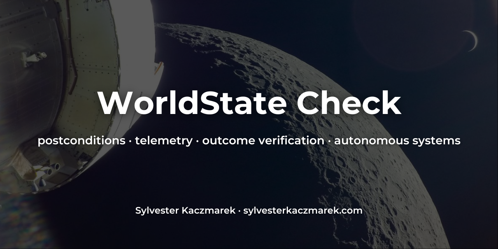

# WorldState Check



[](https://github.com/sylvesterkaczmarek/worldstate-check/actions/workflows/ci.yml)
[](https://doi.org/10.5281/zenodo.24410083)
[](https://pypi.org/project/worldstate-check/)


**Check whether observed state satisfies the conditions an agent claims it achieved.**

A rollout serves healthy v1, then unhealthy v2. Checking health on the first request and version on the second can report a healthy v2 that nobody observed. WorldState Check evaluates both predicates against one HTTP response per attempt. The operator can inspect which reading determined the verdict.

The CLI and Python API check files, JSON, services and telemetry. A report records the decision. An optional recording retains the evidence needed to recompute it offline.

## Try a recorded robot placement

In a fresh Python 3.10+ environment, install version 0.3.0 and replay the bundled trace:

```bash
python -m pip install worldstate-check==0.3.0
worldstate-check replay --example placement
```

The cube starts in the target region and slips after the simulated gripper withdraws. The verifier returns `NOT_VERIFIED` (exit 1) and identifies sample 100 at 0.5 seconds as the first reading where `good` was false. This example runs from the installed wheel, offline, without the simulator.

From a source checkout, record and replay a passing maintenance example:

```bash
worldstate-check verify examples/field-maintenance.yaml --record pump-run.json
worldstate-check replay pump-run.json --json
```

Recordings contain raw inputs, including the specification and any captured command output. Choose an evaluator-owned observation source and storage appropriate for those inputs. [Replay and migration](https://github.com/sylvesterkaczmarek/worldstate-check/blob/v0.3.0/docs/observation-replay.md)

## Research pilot

A paired deployment and MuJoCo placement pilot tests which observations distinguish a completed task from one that only looks complete. It includes 66 labelled episodes, four evidence views, five methods and the full per-episode decisions. The sampled-window checker reduced false acceptances on the held-out families and also abstained on genuine successes. An equally informed hand-written checker matched its decisions. [Methods, results and reproduction](https://github.com/sylvesterkaczmarek/worldstate-check/blob/v0.3.0/research/paired_outcomes/README.md) · [Inspect AI example](https://github.com/sylvesterkaczmarek/worldstate-check/blob/v0.3.0/examples/inspect/task.py)

## Check types

| Type | What it verifies |
| --- | --- |
| `file` | existence, text assertions, SHA-256 |
| `json` | structured state through deterministic field comparisons |
| `metric` | JSON or CSV telemetry, thresholds, ranges, freshness |
| `window` | a predicate over attributable, distinct samples across a specified interval |
| `http` | status, response text, JSON response state; network access is opt-in |
| `tcp` | endpoint reachability; network access is opt-in |
| `command` | explicit verification commands, opt-in only |

Required checks produce one of three verdicts:

- `VERIFIED` when every required postcondition passes;
- `NOT_VERIFIED` when at least one required postcondition fails;
- `UNCERTAIN` when no required check fails but reliable evidence is unavailable for one or more required checks.

## Quick start

For a standalone installation from PyPI:

```bash
pipx install worldstate-check
```

Or install the package with pip:

```bash
python3 -m pip install worldstate-check
```

Then run:

```bash
worldstate-check --version
worldstate-check demo
```

### Install from source

If you prefer to install directly from the repository:

```bash
git clone https://github.com/sylvesterkaczmarek/worldstate-check.git
cd worldstate-check
python3 -m pip install .
worldstate-check demo
```

Run a passing synthetic scenario:

```bash
worldstate-check demo --scenario verified
```

Create a starter specification:

```bash
worldstate-check init worldstate.yaml
```

Validate it without touching any evidence source:

```bash
worldstate-check validate worldstate.yaml
```

The starter reads `result.json` beside the specification. In a new example directory, create a synthetic completed result, then verify it:

```bash
python -c "import json; json.dump({'status': 'complete'}, open('result.json', 'x'))"
worldstate-check verify worldstate.yaml
```

Both required checks should pass. For your own task, point the specification at evidence collected from the system under test.

Specifications that intentionally contact HTTP or TCP endpoints must opt in:

```bash
worldstate-check verify deployment.yaml --allow-network
```

Write a machine-readable evidence report:

```bash
worldstate-check verify worldstate.yaml --report evidence.json
worldstate-check verify-report evidence.json
```

## Python API

The CLI remains the primary interface. Applications can embed the same deterministic verification path from either a specification file or an in-memory Python dictionary.

File-based:

```python
from worldstate_check import Verdict, verify_spec

report = verify_spec("worldstate.yaml")
if report.verdict is Verdict.VERIFIED:
    print("verified")
```

In-memory:

```python
from worldstate_check import verify_spec_data

specification = {
    "version": 1,
    "task": "confirm-state",
    "checks": [
        {
            "id": "state",
            "type": "json",
            "path": "state.json",
            "field": "status",
            "operator": "eq",
            "value": "complete",
        }
    ],
}

report = verify_spec_data(specification, root="./evidence")
```

Both APIs use the same verification context, safety defaults, and deterministic engine as `worldstate-check verify`. Command checks, network checks, and paths outside the verification root remain opt-in. See [docs/python-api.md](https://github.com/sylvesterkaczmarek/worldstate-check/blob/v0.3.0/docs/python-api.md) for additional embedding examples.

## Verification specification

```yaml
version: 1
task: spacecraft-safe-mode

checks:
  - id: payload-off
    type: json
    path: telemetry.json
    field: payload.power
    operator: eq
    value: "off"

  - id: attitude-error
    type: metric
    source:
      type: json
      path: telemetry.json
      field: attitude.error_deg
    operator: lte
    value: 3.0

  - id: battery-reserve
    type: metric
    source:
      type: json
      path: telemetry.json
      field: battery.soc
    operator: gte
    value: 25.0
```

See [docs/specification.md](https://github.com/sylvesterkaczmarek/worldstate-check/blob/v0.3.0/docs/specification.md) for all supported checks.

## Observation consistency

Checks reading the same resolved local file within one attempt share its captured
bytes. HTTP checks on the same URL and sample share one response. Later retries reacquire evidence. This is per-source consistency, without
an atomic snapshot across different sources or a guarantee about state after the
observation. Command/network operations remain opt-in.

The saved report verifier checks schema, required counts, verdict consistency and
SHA-256. Its checksum provides no source authentication or protection against an
attacker who can replace the report and recompute it.

## Telemetry freshness

A value can be numerically valid and still be unsafe evidence if it is stale. Metric checks can require a recent timestamp:

```yaml
- id: temperature
  type: metric
  source:
    type: json
    path: telemetry.json
    field: temperature_c
    timestamp_field: observed_at
    max_age_seconds: 5
  operator: lte
  value: 75
```

Stale required telemetry causes `NOT_VERIFIED` because the available observation does not satisfy the declared freshness postcondition.

## Waiting for eventual state

Some effects are asynchronous. `--wait` re-evaluates the postconditions until they pass or the timeout expires:

```bash
worldstate-check verify deployment.yaml --wait 30
```

The report records the number of attempts. Keep verification checks idempotent when using retries.

## Safety boundaries

WorldState Check treats the verification specification as potentially powerful input.

- evidence paths are confined to the verification root by default;
- paths outside that root require `--allow-outside-root`;
- command checks require `--allow-command`;
- HTTP and TCP checks require `--allow-network`;
- commands use an argument vector with `shell=False`;
- command checks receive only a minimal environment and do not copy raw argv or output into evidence reports;
- HTTP evidence redacts URL credentials, query strings, and fragments;
- specifications and evidence reads have explicit size limits.

See [docs/security.md](https://github.com/sylvesterkaczmarek/worldstate-check/blob/v0.3.0/docs/security.md).

## Example physical-system checks

The repository contains two runnable file-backed examples:

```bash
worldstate-check verify examples/field-maintenance.yaml
worldstate-check verify examples/spacecraft-safe-mode.yaml
```

The first is expected to verify. The second is intentionally expected to return `NOT_VERIFIED` because the attitude-error postcondition fails.

## Evidence report

JSON reports include:

- task and final verdict;
- expected and observed values, with digest references for large values;
- required versus optional checks;
- timing and attempt count;
- source metadata such as evidence path, endpoint, or telemetry age;
- a SHA-256 digest of the report payload.

`worldstate-check verify-report` recomputes that digest and reports whether the saved payload still matches it. The digest is not a digital signature and does not establish the identity or trustworthiness of the evidence source.

## Assurance model

WorldState Check verifies declared postconditions against observations. It does not prove that sensors, endpoints, files, or other evidence sources are trustworthy or correctly calibrated. It also does not determine whether the original intent was safe.

See [docs/assurance-model.md](https://github.com/sylvesterkaczmarek/worldstate-check/blob/v0.3.0/docs/assurance-model.md) for the exact scope.

## Repository layout

```text
worldstate-check/
├── .github/workflows/
│   ├── ci.yml
│   └── release.yml
├── assets/social/
├── docs/
├── examples/
├── src/worldstate_check/
│   ├── api.py
│   ├── checks/
│   ├── cli.py
│   ├── engine.py
│   ├── loader.py
│   ├── models.py
│   └── report.py
├── tests/
├── .release-version
├── CITATION.cff
├── LICENSE
├── Makefile
├── pyproject.toml
└── README.md
```

## Development

```bash
python -m pip install -e '.[dev]'
pytest
```

The core verdict path is deterministic and does not call an LLM.

## Cite this repository

Kaczmarek, S. (2026). *WorldState Check* (Version 0.3.0) [Computer software]. Zenodo. https://doi.org/10.5281/zenodo.24410083

Use the DOI above to cite this release and its paired outcomes pilot. [DOI for all versions](https://doi.org/10.5281/zenodo.24410082).

## License

MIT. See [LICENSE](https://github.com/sylvesterkaczmarek/worldstate-check/blob/v0.3.0/LICENSE).

© **Sylvester Kaczmarek** · [https://www.sylvesterkaczmarek.com](https://www.sylvesterkaczmarek.com)
